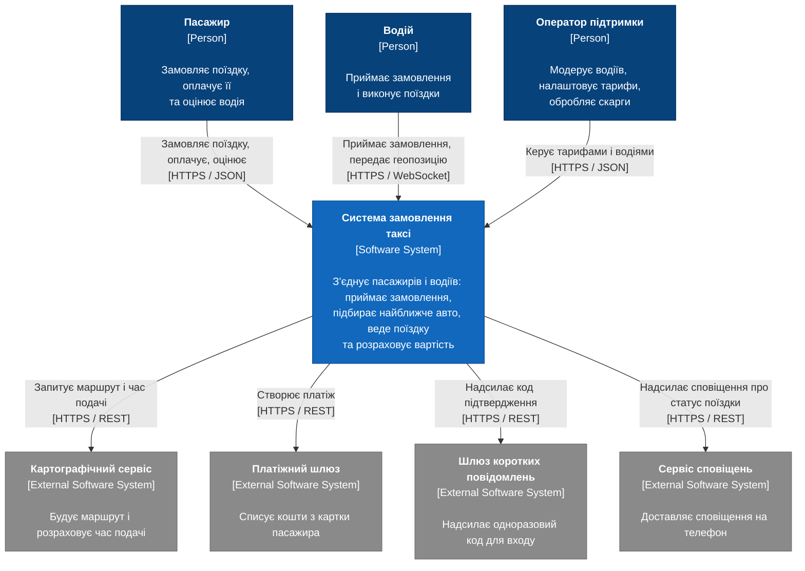

# C1 — System Context diagram: система замовлення таксі

Погляд на систему ззовні: вона показана однією коробкою, а навколо — ті, хто нею користується, і зовнішні сервіси, без яких вона не працює. На цьому рівні немає жодної технології, бо він призначений для замовника, а не для розробника.

## Учасники

| Елемент | Тип | Роль |
|---|---|---|
| Пасажир | Людина | Замовляє поїздку, оплачує її та оцінює водія |
| Водій | Людина | Приймає замовлення і виконує поїздки |
| Оператор підтримки | Людина | Модерує водіїв, налаштовує тарифи, обробляє скарги |
| Система замовлення таксі | Наша система | З'єднує пасажирів і водіїв |
| Картографічний сервіс | Зовнішня система | Маршрут, відстань, час подачі |
| Платіжний шлюз | Зовнішня система | Списання коштів з картки |
| Шлюз коротких повідомлень | Зовнішня система | Одноразовий код для входу |
| Сервіс сповіщень | Зовнішня система | Push-сповіщення на телефон |

Наступний рівень: [C2 — Containers](c2-containers.md).
