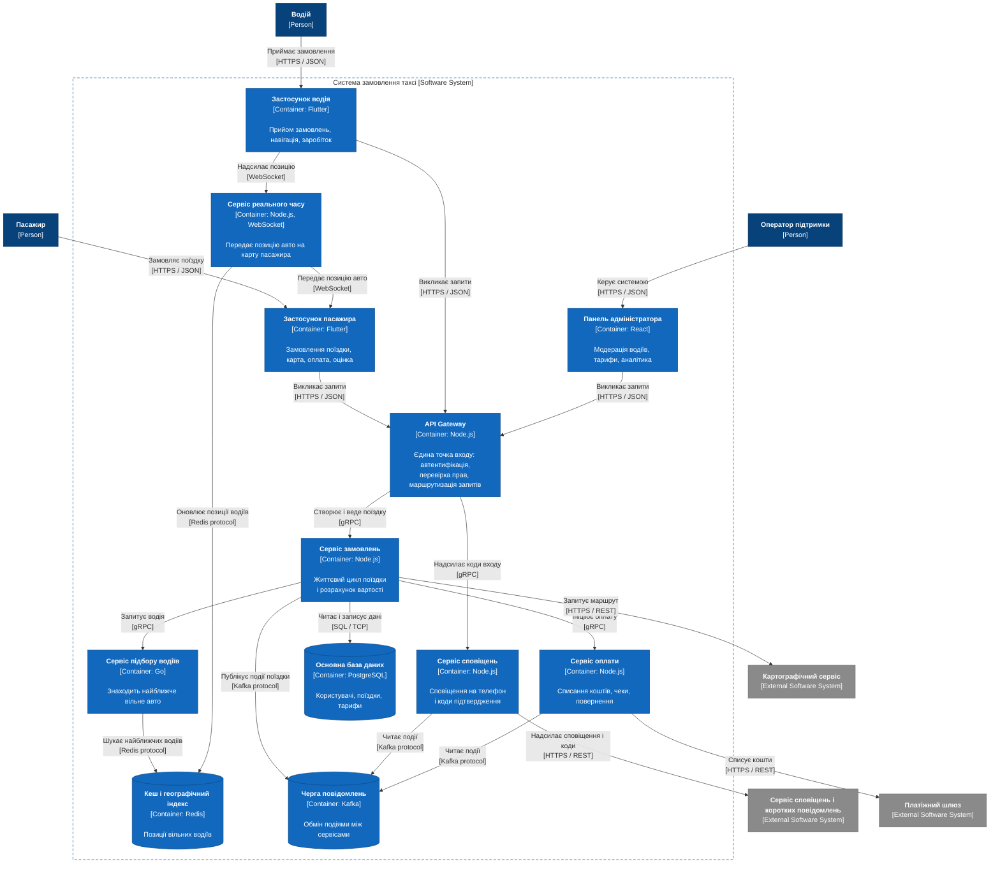

# C2 — Container diagram: система замовлення таксі

Систему розкрито на окремі застосунки й сервіси, кожен зі своєю технологією: мобільні клієнти, шлюз, сервіс реального часу, чотири внутрішні сервіси та три сховища.

**Контейнер** у C4 — це не Docker, а окремо запущена одиниця, всередині якої виконується код або зберігаються дані. Критерій простий: якщо щось можна зупинити й перезапустити незалежно від решти — це окремий контейнер. Застосунок на телефоні — теж контейнер. Бібліотека чи модуль усередині процесу контейнером не є.

## Склад діаграми

**Клієнтський ряд.** Три застосунки для трьох ролей: пасажирський і водійський на Flutter, адмінка на React. Вони окремі, бо сценарії принципово різні: водієві потрібне фонове відстеження позиції й робота офлайн, пасажирові — ні. Див. [ADR-0003](adr/0003-flutter-and-react-clients.md).

**API Gateway.** Єдина точка входу для всіх трьох клієнтів. Бере на себе те, що інакше довелося б дублювати в кожному сервісі: перевірку токена, права доступу, обмеження частоти запитів, маршрутизацію. Див. [ADR-0004](adr/0004-api-gateway-single-entry-point.md).

**Сервіс реального часу.** Винесений окремо від шлюзу. Звичайні запити живуть частки секунди, а WebSocket-з'єднання висить годинами, поки триває поїздка. Масштабуються вони теж по-різному: шлюз — за кількістю запитів, сервіс реального часу — за кількістю активних з'єднань. Див. [ADR-0005](adr/0005-separate-realtime-service.md).

**Чотири внутрішні сервіси.** Поділ іде за зонами відповідальності, а не за сутностями бази. Див. [ADR-0006](adr/0006-services-by-responsibility.md).

**Три сховища.** PostgreSQL — джерело істини: користувачі, поїздки, тарифи, платежі. Redis — позиції вільних водіїв, які змінюються кожні кілька секунд. Kafka — асинхронний обмін подіями між сервісами. Див. [ADR-0007](adr/0007-postgresql-as-source-of-truth.md), [ADR-0008](adr/0008-redis-geo-index-for-driver-positions.md), [ADR-0009](adr/0009-kafka-for-async-events.md).

## Контейнери

| Контейнер | Технологія | Відповідальність | Як масштабується | Вимоги |
|---|---|---|---|---|
| Застосунок пасажира | Flutter | Замовлення, карта, оплата, оцінка | — | FR-1 … FR-19 |
| Застосунок водія | Flutter | Прийом замовлень, навігація, заробіток | — | FR-20 … FR-28 |
| Панель адміністратора | React | Модерація, тарифи, аналітика | — | FR-29 … FR-34 |
| API Gateway | Node.js | Автентифікація, права, rate limiting, маршрутизація | За кількістю запитів | NFR-3, NFR-11, NFR-13, NFR-14 |
| Сервіс реального часу | Node.js, WebSocket | Позиція авто й статуси поїздки наживо | За кількістю активних з'єднань | FR-10, NFR-2 |
| Сервіс замовлень | Node.js | Життєвий цикл поїздки, вартість, скасування | За кількістю поїздок | FR-5, FR-9, FR-24, FR-37 |
| Сервіс підбору водіїв | Go | Пошук найближчого вільного авто | За кількістю пошуків | FR-22, FR-35, NFR-1 |
| Сервіс оплати | Node.js | Списання, чеки, повернення | За кількістю платежів | FR-15, FR-18, FR-32, NFR-12 |
| Сервіс сповіщень | Node.js | Push-сповіщення, коди підтвердження | За кількістю подій | FR-1, FR-14 |
| Основна база даних | PostgreSQL | Користувачі, поїздки, тарифи, платежі | Репліки для читання | NFR-10 |
| Кеш і геоіндекс | Redis | Позиції вільних водіїв | Кластер | NFR-1 |
| Черга повідомлень | Kafka | Події між сервісами | Партиції | NFR-8 |

Попередній рівень: [C1 — System Context](c1-system-context.md). Наступний рівень: [C3 — Components](c3-order-service.md).
