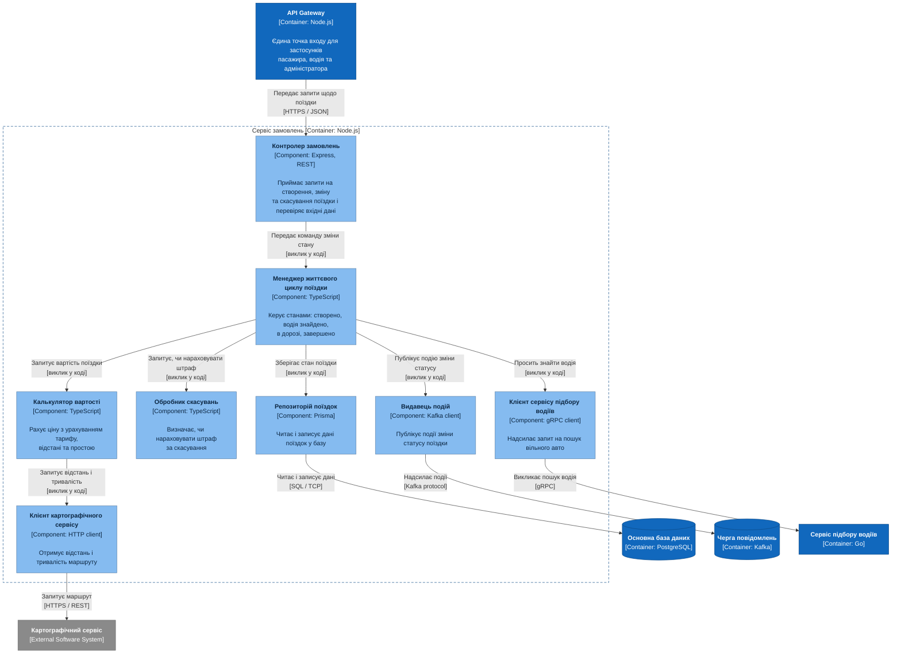
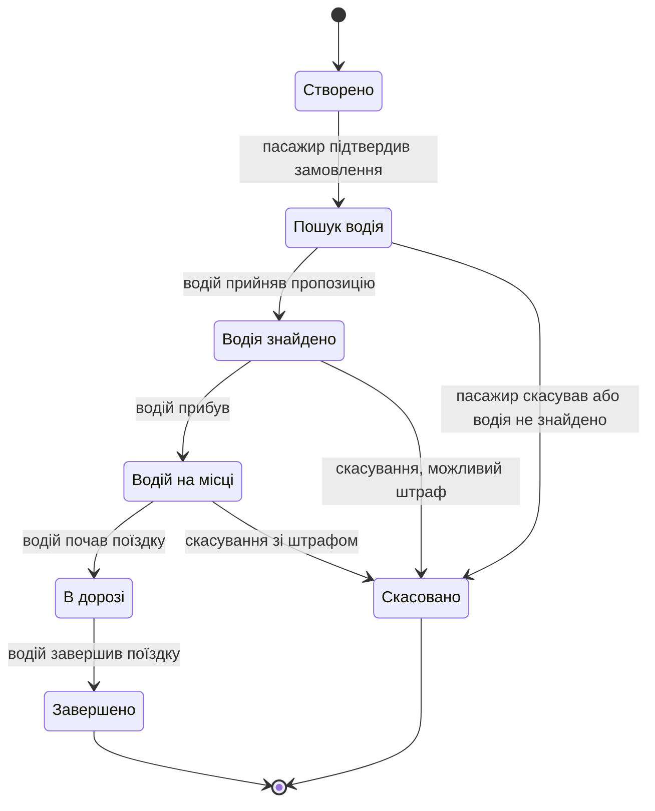

# C3 — Component diagram: сервіс замовлень

**Компонент** — логічно згрупований блок коду всередині одного контейнера: пакет, модуль, набір класів за спільним інтерфейсом. Окремо він не запускається, живе в тому ж процесі, що й решта компонентів контейнера.

На рівні C3 розкривають **один** контейнер. Обрано сервіс замовлень, бо він містить основну бізнес-логіку. Решта сервісів здебільшого є тонкими обгортками над зовнішніми інтеграціями: сервіс оплати фактично передає виклик платіжному шлюзу, сервіс сповіщень — провайдеру push.

## Компоненти

| Компонент | Роль |
|---|---|
| Контролер замовлень | Приймає HTTP-запити від шлюзу, перевіряє вхідні дані, передає команду далі. Бізнес-логіки в ньому немає — лише перетворення запиту на виклик |
| Менеджер життєвого циклу | Серце сервісу. Реалізує скінченний автомат станів поїздки і стежить, щоб неможливі переходи не відбувалися. Координує решту компонентів |
| Калькулятор вартості | Чистий розрахунок: тариф, відстань, час, простій, коефіцієнт попиту. Винесений окремо, бо правила ціноутворення змінюються найчастіше |
| Обробник скасувань | Вирішує, чи нараховувати штраф, залежно від часу й того, чи встиг водій виїхати |
| Репозиторій поїздок | Єдине місце, яке знає про базу. Решта працює з об'єктами предметної області й не бачить SQL |
| Видавець подій | Адаптер до черги: перетворює подію бізнес-логіки на повідомлення Kafka |
| Клієнт сервісу підбору | Адаптер до сервісу підбору водіїв через gRPC |
| Клієнт картографічного сервісу | Адаптер до зовнішніх карт через HTTP |

## Шари

Компоненти діляться на три шари, і це видно за розташуванням на діаграмі:

1. **Вхід у систему** — контролер.
2. **Чиста логіка**, яка нічого не знає про зовнішній світ — менеджер життєвого циклу, калькулятор вартості, обробник скасувань.
3. **Адаптери** до всього зовнішнього — репозиторій, видавець подій, клієнти.

Залежності йдуть лише згори вниз. Логіка не залежить від бази чи протоколів, а навпаки — адаптери підлаштовуються під неї. Це гексагональна архітектура (ports and adapters), див. [ADR-0011](adr/0011-hexagonal-architecture-order-service.md).

## Стани поїздки

Менеджер життєвого циклу допускає лише такі переходи:

## Відмова зовнішнього сервісу

Якщо сервіс підбору або карти недоступні, адаптер повертає помилку, менеджер переводить поїздку в очікування або скасовує її, а пасажир отримує сповіщення. Саме заради такої ізоляції адаптери й виділяють.

Чому клієнти зовнішніх сервісів — компоненти, а не контейнери: це код усередині того самого процесу, а не окремо запущена програма. Контейнером є сам сервіс підбору водіїв.

Попередній рівень: [C2 — Containers](c2-containers.md).
