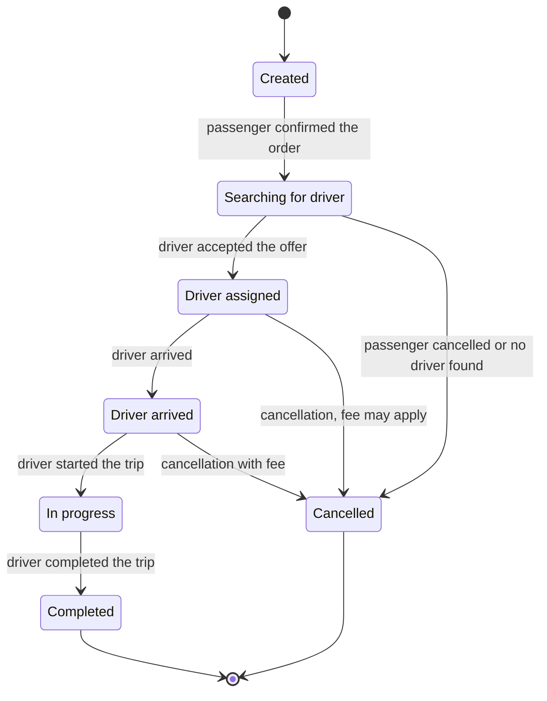

# C3 — Component diagram: Order service

A **component** is a logically grouped block of code inside one container: a package, a module, a set of classes behind a common interface. It does not run on its own; it lives in the same process as the other components of the container.

At the C3 level only **one** container is opened up. The order service was chosen because it holds the core business logic. The other services are mostly thin wrappers around external integrations: the payment service essentially forwards calls to the payment gateway, the notification service to the push provider.

## Components

| Component | Role |
|---|---|
| Order controller | Accepts HTTP requests from the gateway, validates input, passes the command on. Contains no business logic — it only turns a request into a call |
| Trip lifecycle manager | The heart of the service. Implements the trip state machine and prevents impossible transitions. Coordinates the other components |
| Price calculator | Pure calculation: tariff, distance, time, waiting, surge multiplier. Kept separate because pricing rules change most often |
| Cancellation handler | Decides whether to charge a fee based on timing and whether the driver has already set off |
| Trip repository | The only place that knows about the database. Everything else works with domain objects and never sees SQL |
| Event publisher | Adapter to the broker: turns a business event into a Kafka message |
| Matching service client | Adapter to the driver matching service over gRPC |
| Maps service client | Adapter to the external maps API over HTTP |

## Layers

The components fall into three layers, which is visible from their position on the diagram:

1. **Entry point** — the controller.
2. **Pure logic** that knows nothing about the outside world — the lifecycle manager, price calculator, cancellation handler.
3. **Adapters** to everything external — the repository, event publisher, clients.

Dependencies only point downwards. The logic does not depend on the database or protocols; the adapters adapt to the logic instead. This is hexagonal architecture (ports and adapters), see [ADR-0011](adr/0011-hexagonal-architecture-order-service.md).

## Trip states

The lifecycle manager allows only these transitions:

## External service failure

If the matching service or the maps API is unavailable, the adapter returns an error, the lifecycle manager puts the trip on hold or cancels it, and the passenger is notified. Adapters are separated precisely for this kind of isolation.

Why external service clients are components rather than containers: they are code inside the same process, not a separately running program. The container is the driver matching service itself.

Previous level: [C2 — Containers](c2-containers.md).
