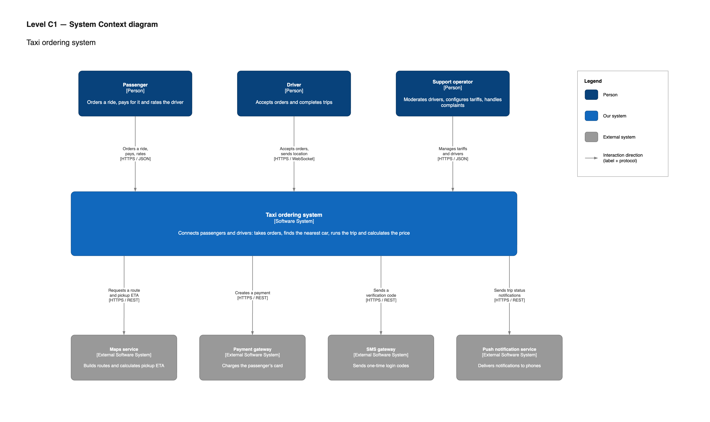

# C1 — System Context diagram: Taxi ordering system (ideal)

The system seen from the outside: it is shown as a single box, surrounded by the people who use it and the external services it cannot work without. There are no technologies at this level because it is meant for the client, not for developers.

The system context is the same in the [starting architecture](../starting/c1-system-context.md): only the internals differ.

*Source: [`taxi-c4-model.drawio`](diagrams/taxi-c4-model.drawio), page "C1 — System Context". Open it at [app.diagrams.net](https://app.diagrams.net) to edit.*

## Elements

| Element | Type | Role |
|---|---|---|
| Passenger | Person | Orders a ride, pays for it and rates the driver |
| Driver | Person | Accepts orders and completes trips |
| Support operator | Person | Moderates drivers, configures tariffs, handles complaints |
| Taxi ordering system | Our system | Connects passengers and drivers |
| Maps service | External system | Routes, distance, pickup ETA |
| Payment gateway | External system | Card charges |
| SMS gateway | External system | One-time login codes |
| Push notification service | External system | Push notifications to phones |

Next level: [C2 — Containers](c2-containers.md).
