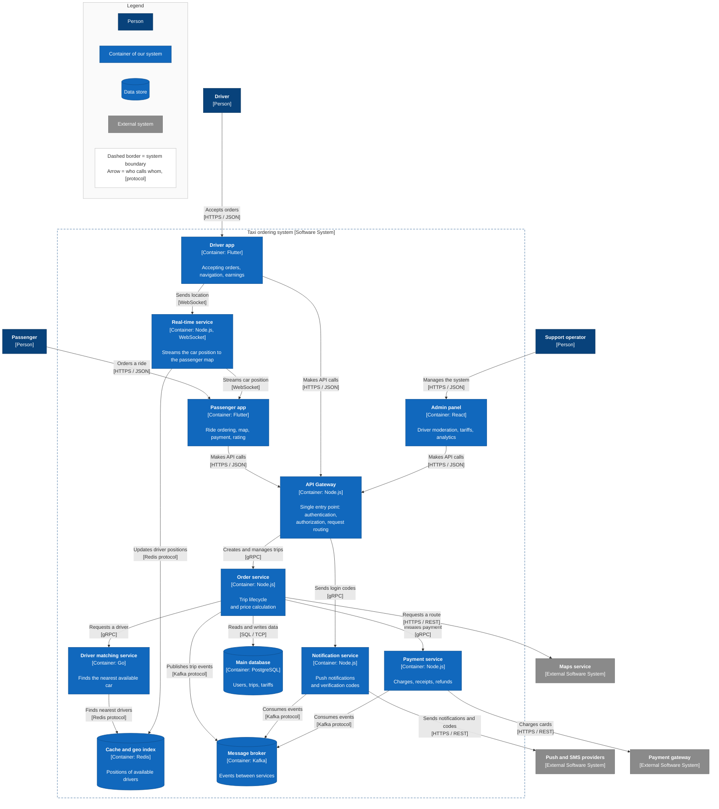

# C2 — Container diagram: Taxi ordering system (ideal)

The system is broken down into separate apps and services, each with its own technology: mobile clients, a gateway, a real-time service, four internal services and three data stores.

A **container** in C4 is not Docker — it is a separately running unit that executes code or stores data. The test is simple: if it can be stopped and restarted independently of everything else, it is a separate container. A mobile app on a phone is a container too. A library or module inside a process is not.

## What is on the diagram

**Client row.** Three apps for three roles: passenger and driver apps in Flutter, admin panel in React. They are separate because the scenarios are fundamentally different: the driver needs background location tracking and offline work, the passenger does not. See [ADR-0003](../adr/0003-flutter-and-react-clients.md).

**API Gateway.** The single entry point for all three clients. It takes over what would otherwise be duplicated in every service: token validation, access rights, rate limiting, routing. See [ADR-0004](../adr/0004-api-gateway-single-entry-point.md).

**Real-time service.** Kept separate from the gateway. Regular requests live for a fraction of a second, while a WebSocket connection stays open for hours during a trip. They also scale differently: the gateway by request count, the real-time service by the number of open connections.

**Four internal services.** Split by area of responsibility, not by database entities. The order service runs a trip from creation to completion. The matching service finds the nearest available car and is written in Go because it is the hottest path under load. The payment service is isolated because it handles payment data and has separate security requirements. The notification service keeps all delivery channels in one place.

**Three data stores.** PostgreSQL is the source of truth: users, trips, tariffs, payments. Redis holds the positions of available drivers, which change every few seconds — writing them to a relational database makes no sense, and the Redis geo index finds the nearest drivers in milliseconds. Kafka carries asynchronous events between services.

## Containers

| Container | Technology | Responsibility | Scales by | Requirements |
|---|---|---|---|---|
| Passenger app | Flutter | Ordering, map, payment, rating | — | FR-1 … FR-19 |
| Driver app | Flutter | Accepting orders, navigation, earnings | — | FR-20 … FR-28 |
| Admin panel | React | Moderation, tariffs, analytics | — | FR-29 … FR-34 |
| API Gateway | Node.js | Authentication, authorization, rate limiting, routing | Request count | NFR-3, NFR-11, NFR-13, NFR-14 |
| Real-time service | Node.js, WebSocket | Live car position and trip status | Open connections | FR-10, NFR-2 |
| Order service | Node.js | Trip lifecycle, pricing, cancellations | Number of trips | FR-5, FR-9, FR-24, FR-37 |
| Driver matching service | Go | Finding the nearest available car | Number of searches | FR-22, FR-35, NFR-1 |
| Payment service | Node.js | Charges, receipts, refunds | Number of payments | FR-15, FR-18, FR-32, NFR-12 |
| Notification service | Node.js | Push notifications, verification codes | Number of events | FR-1, FR-14 |
| Main database | PostgreSQL | Users, trips, tariffs, payments | Read replicas | NFR-10 |
| Cache and geo index | Redis | Positions of available drivers | Cluster | NFR-1 |
| Message broker | Kafka | Events between services | Partitions | NFR-8 |

Previous level: [C1 — System Context](c1-system-context.md). Next level: [C3 — Components](c3-order-service.md).
