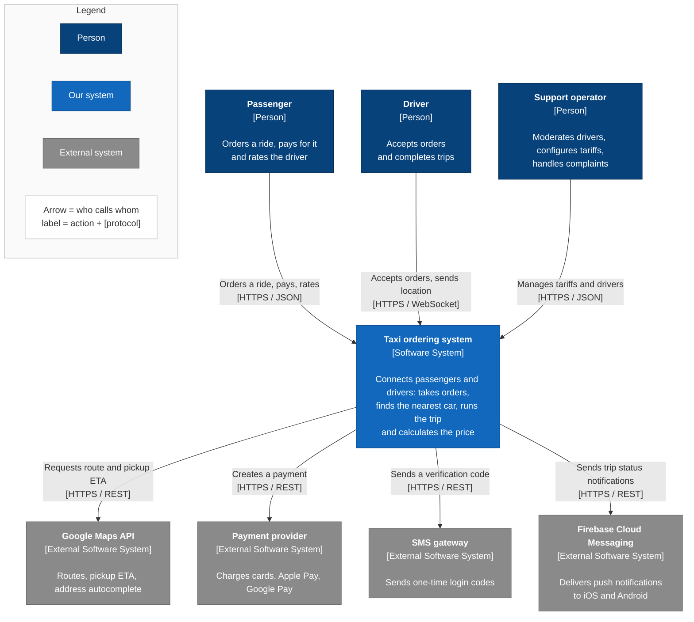

# C1 — System Context diagram: Taxi ordering system (starting)

The system context is the same as in the [ideal architecture](../ideal/c1-system-context.md): the same users and the same external systems. Simplifying the internals does not change what the system does for its users or which external services it depends on.

At the starting stage the external systems are named concretely because they are fixed by the constraints: Google Maps ([CON-5](../../requirements/constraints.md)), a single payment provider ([CON-6](../../requirements/constraints.md)), and Firebase Cloud Messaging, which delivers push to both iOS and Android through one API.

Next level: [C2 — Containers](c2-containers.md).
