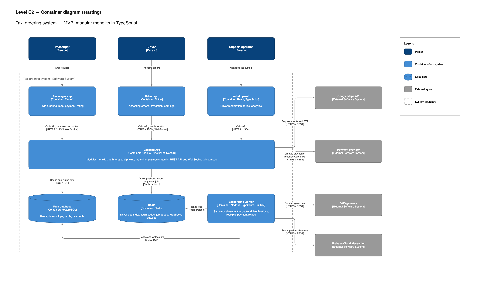

# C2 — Container diagram: Taxi ordering system (starting)

Seven containers instead of twelve: three client apps, one backend, one background worker and two data stores. All server-side code is TypeScript. The reasoning for every change is in the [component analysis](README.md#component-analysis).

*Source: [`taxi-c4-model-starting.drawio`](diagrams/taxi-c4-model-starting.drawio), page "C2 — Containers". Open it at [app.diagrams.net](https://app.diagrams.net) to edit.*

## What is on the diagram

**Client row — unchanged.** Passenger and driver apps in Flutter ([CON-4](../../requirements/constraints.md), [ADR-0003](../adr/0003-flutter-and-react-clients.md)), sharing Flutter packages. Admin panel in React with TypeScript.

**Backend API.** One NestJS application that replaces the gateway, the real-time service and four services of the ideal architecture. Inside it is split into modules with the same boundaries as the ideal services, see [C3](c3-backend-api.md). It runs as two instances behind a managed load balancer, so clients know one address ([ADR-0004](../adr/0004-api-gateway-single-entry-point.md)).

**Background worker.** The same codebase started in worker mode. It processes jobs from the Redis queue: push notifications, SMS codes, receipts, payment retries, clean-up of old location data ([NFR-16](../../requirements/non-functional.md)). Slow external calls never block an API request.

**Two data stores.** PostgreSQL is the source of truth. Redis is the only extra technology on the server side and is used for five jobs: driver geo index, login codes and offer timers with TTL, job queue, WebSocket pub/sub between instances, rate-limit counters.

## Containers

| Container | Technology | Responsibility | Instances | Requirements |
|---|---|---|---|---|
| Passenger app | Flutter | Ordering, map, payment, rating | — | FR-1 … FR-19 |
| Driver app | Flutter | Accepting orders, navigation, earnings | — | FR-20 … FR-28 |
| Admin panel | React, TypeScript | Moderation, tariffs, analytics | — | FR-29 … FR-34 |
| Backend API | Node.js, TypeScript, NestJS, Socket.IO | REST API, WebSocket, all business logic | 2 | FR-1 … FR-38, NFR-1, NFR-3 |
| Background worker | Node.js, TypeScript, BullMQ | Notifications, receipts, payment retries, clean-up jobs | 1 | FR-14, FR-15, FR-18, NFR-16, NFR-17 |
| Main database | PostgreSQL (managed) | Users, drivers, trips, tariffs, payments | Primary + standby | NFR-10 |
| Redis | Redis (managed) | Geo index, TTL keys, job queue, pub/sub, rate limits | Primary + replica | NFR-1, NFR-2, NFR-13 |

## Compared with the ideal C2

| | Ideal | Starting |
|---|---|---|
| Containers | 12 | 7 |
| Server-side deployables | 6 (gateway, real-time, 4 services) | 2 (backend, worker) |
| Server-side languages | TypeScript, Go | TypeScript |
| Data stores | PostgreSQL, Redis, Kafka | PostgreSQL, Redis |
| Communication between services | gRPC + Kafka | In-process calls + Redis job queue |

Previous level: [C1 — System Context](c1-system-context.md). Next level: [C3 — Components](c3-backend-api.md).
