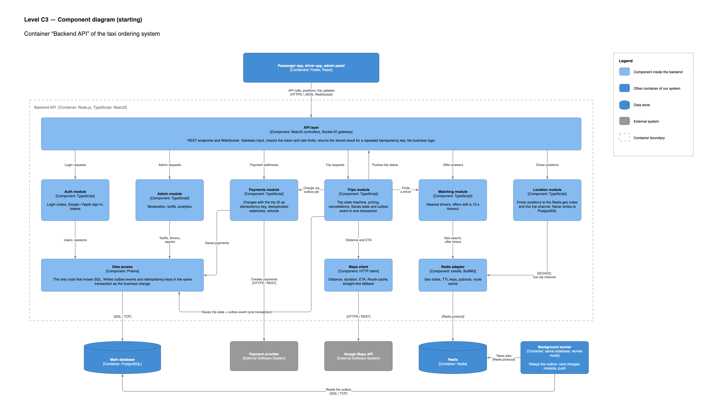

# C3 — Component diagram: Backend API (starting)

The backend API is the only container with business logic, so it is the one opened up at C3. Its modules have the same boundaries as the services of the [ideal architecture](../ideal/c2-containers.md): the trips module is the future order service, the matching module is the future matching service, the payments module is the future payment service.

*Source: [`taxi-c4-model-starting.drawio`](diagrams/taxi-c4-model-starting.drawio), page "C3 — Components". Open it at [app.diagrams.net](https://app.diagrams.net) to edit.*

## Components

| Component | Role | Becomes in the ideal architecture |
|---|---|---|
| API layer | NestJS controllers for REST and a Socket.IO gateway for WebSocket. Validates input, checks the access token, applies rate limits, returns the stored result for a repeated idempotency key. No business logic | API Gateway + real-time service |
| Auth module | Login codes (6 digits, 5 min TTL in Redis), Google / Apple sign-in, access and refresh tokens | Part of the gateway |
| Admin module | Driver moderation, tariff management, analytics queries | Admin endpoints of the services |
| Trips module | Trip state machine, cancellations and fees, price calculation with the shared pricing package ([`packages/shared/pricing.js`](../../../packages/shared/pricing.js)). Saves the trip state and the outbox event (charge, push, receipt) in one transaction | Order service |
| Matching module | Nearest drivers via Redis `GEOSEARCH`, ranking, offers with a 15 s timeout | Driver matching service |
| Location module | Receives driver positions, updates the Redis geo index and the live trip channel, appends track points to a Redis stream. Never writes to PostgreSQL ([ADR-0007](../adr/0007-driver-positions-in-redis-only.md)) | Real-time service |
| Payments module | Payment provider client with the trip ID as the idempotency key, webhook deduplication by payment ID, refunds, reconciliation | Payment service |
| Data access | Prisma client and migrations; the only place that knows the database schema. Writes outbox events and idempotency keys in the same transaction as the business change | Repositories in each service |
| Maps client | Google Maps calls for distance, duration and ETA; route cache in Redis; circuit breaker with a straight-line fallback (UP-22) | Maps client of the order service |
| Redis adapter | ioredis and BullMQ: geo index, TTL keys, job queue, pub/sub between instances, route cache | Redis client |

## Rules inside the monolith

The modules live in one process, so nothing technically stops them from calling each other's internals. These rules keep extraction into services possible later:

1. **A module talks to another module only through its public interface** (an exported NestJS service), never through its database tables.
2. **Each module owns its tables.** The trips module does not write to payment tables directly — it asks the payments module.
3. **Business logic does not know about NestJS, Prisma or Redis.** Logic calls interfaces; the data access, maps client and Redis adapter implement them — the same ports-and-adapters idea as in the [ideal C3](../ideal/c3-order-service.md).

## How jobs leave the backend

The trips module does not enqueue jobs into Redis itself. Writing to PostgreSQL and then to Redis is a dual write: a crash between the two steps would lose the card charge. Instead, the trip state and the outbox event are saved in one transaction, and the background worker — the same codebase in worker mode — relays the outbox and executes the job ([ADR-0006](../adr/0006-idempotent-actions-offline-queue-and-outbox.md)). Offers to drivers do not go through the outbox: they are latency-critical and handled by the matching module directly.

Trip states are the same as in the ideal architecture: see [trip states](../ideal/c3-order-service.md#trip-states).

Previous level: [C2 — Containers](c2-containers.md).
