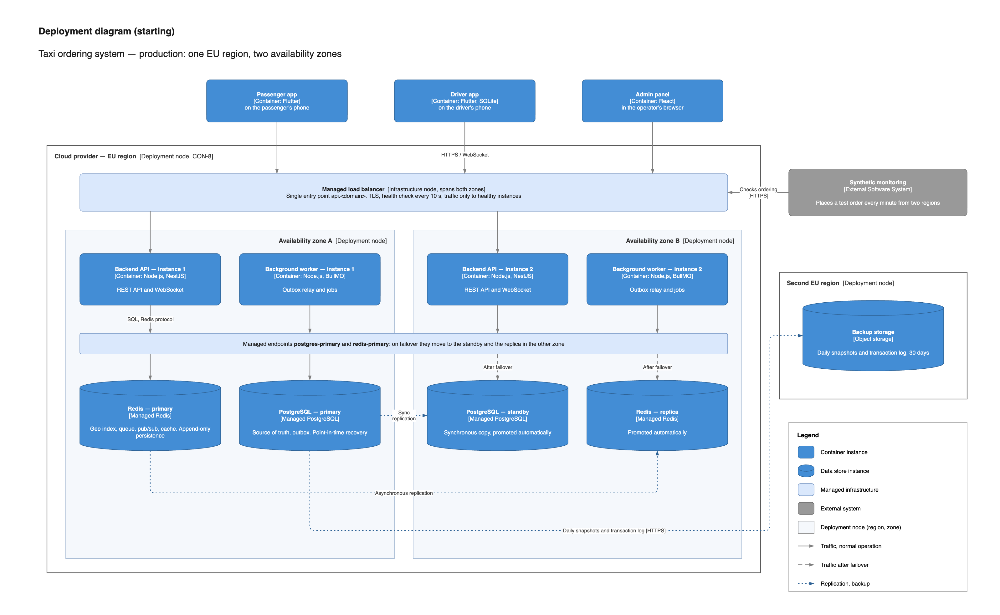

# Deployment diagram: Taxi ordering system (starting)

The C2 diagram shows *what* runs; this diagram shows *where* it runs and how it survives failures. It exists because of availability, one of the three top [architecture characteristics](../characteristics.md): "99.9%" changes nothing on C2, while two zones, a standby and failover only become visible here. Decision: [ADR-0005](../adr/0005-two-availability-zones-with-failover.md).

*Source: [`taxi-c4-model-starting.drawio`](diagrams/taxi-c4-model-starting.drawio), page "Deployment". Open it at [app.diagrams.net](https://app.diagrams.net) to edit.*

## Nodes

| Node | Runs | In zone A | In zone B | On failure |
|---|---|---|---|---|
| Managed load balancer | TLS, health checks every 10 s, routing | Spans both zones | Spans both zones | Managed by the cloud provider |
| Backend API | NestJS, REST and WebSocket | Instance 1 | Instance 2 | The load balancer sends all traffic to the healthy instance; WebSocket clients reconnect |
| Background worker | BullMQ, outbox relay | Instance 1 | Instance 2 | The other worker keeps taking jobs; jobs are locked, so none is processed twice |
| PostgreSQL (managed) | Main database | Primary | Synchronous standby | The standby is promoted automatically; no committed transaction is lost |
| Redis (managed) | Geo index, queue, pub/sub, cache | Primary | Replica | The replica is promoted; driver positions are rebuilt from the next updates |
| Backup storage | Daily snapshots and transaction log, 30 days | Second EU region | | Restore point for a region-wide outage (hours, see AC-7 in [characteristics](../characteristics.md#left-out-and-the-consequence)) |
| Synthetic monitoring | Test order every minute from two regions | External | | Measures actual availability against NFR-7 |

All instances in both zones connect to the current primaries through managed endpoints. After a failover the endpoint points to the promoted standby or replica, so the backend configuration does not change.

## Scenario

The behaviour on the loss of a whole zone is described as a quality attribute scenario: [QAS-1](../characteristics.md#qas-1-availability-loss-of-an-availability-zone).

Previous: [C2 — Containers](c2-containers.md).
