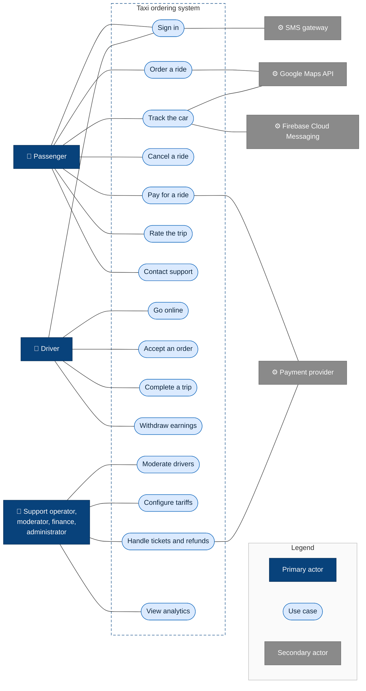

# Actors

An actor is anyone or anything outside the system that interacts with it. **Primary actors** start an interaction to reach their own goal. **Secondary actors** are external systems the taxi system depends on to serve primary actors.

## Primary actors

| Actor | Channel | Goal | Main use cases | Requirements |
|---|---|---|---|---|
| **Passenger** | Passenger mobile app | Get from A to B quickly, safely and at a known price | Sign in, order a ride, track the car, contact the driver, pay, rate, view history, contact support | FR-1 … FR-19 |
| **Driver** | Driver mobile app | Earn money with as little idle time as possible | Register and pass verification, go online, accept offers, navigate, change trip status, withdraw earnings | FR-20 … FR-28 |
| **Support operator** | Admin panel | Resolve passenger and driver problems | Handle tickets, review complaints, monitor active trips, react to SOS | FR-19, FR-29, FR-31, FR-32 |
| **Moderator** | Admin panel | Let only verified drivers and cars work | Review driver documents, approve or block drivers | FR-20, FR-29 |
| **Finance** | Admin panel | Keep money flows correct | Issue refunds, review disputed charges and debts, check driver payouts | FR-26, FR-32 |
| **Administrator** | Admin panel | Configure the business | Manage tariffs, promo codes, admin users and roles; view analytics | FR-30, FR-33, FR-34, NFR-14 |

## Secondary actors

| Actor | What the system needs from it | Used in | If it is unavailable |
|---|---|---|---|
| **Google Maps API** | Address autocomplete, routes, distance, ETA | FR-3, FR-4, FR-5, FR-10, FR-23 | [UP-22](unhappy-paths.md#system) |
| **Payment provider** | Card, Apple Pay and Google Pay charges, refunds, payment confirmations by webhook. Fiscal receipts (NFR-17) are issued through the provider's PRRO integration or a separate PRRO service, decided when the provider is chosen (CON-6) | FR-15, FR-18, FR-32 | [UP-18](unhappy-paths.md#payment) |
| **SMS gateway** | Delivery of one-time login codes | FR-1 | [UP-2](unhappy-paths.md#sign-in) |
| **Firebase Cloud Messaging** | Push notifications to iOS and Android | FR-14 | [UP-25](unhappy-paths.md#system) |
| **Scheduler (time)** | Not an external system but a trigger: actions that start because time passed, not because a person did something | Offer timeouts (FR-22), scheduled rides (FR-7), payment retries (FR-15), data clean-up (NFR-16) | — |

## Use case diagram

## Permissions

Who can do what. Staff roles and two-factor authentication follow [NFR-14](non-functional.md); every staff action is written to the audit log.

| Action | Passenger | Driver | Support operator | Moderator | Finance | Administrator |
|---|---|---|---|---|---|---|
| Order and pay for rides | ✅ | — | — | — | — | — |
| Accept orders, withdraw earnings | — | ✅ | — | — | — | — |
| View own trips and receipts | ✅ | ✅ | — | — | — | — |
| View any trip and its route | — | — | ✅ | ✅ | ✅ | ✅ |
| Monitor active trips on the map, react to SOS | — | — | ✅ | — | — | ✅ |
| Review driver documents, approve or block drivers | — | — | — | ✅ | — | ✅ |
| Handle tickets and complaints | — | — | ✅ | ✅ | — | ✅ |
| Issue refunds, write off debts | — | — | — | — | ✅ | ✅ |
| Change tariffs | — | — | — | — | — | ✅ |
| Manage promo codes | — | — | — | — | — | ✅ |
| View analytics | — | — | — | — | ✅ | ✅ |
| Manage staff accounts and roles | — | — | — | — | — | ✅ |
