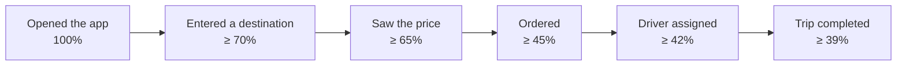

# Success metrics

Product metrics used to judge the success of the MVP. Unlike non-functional requirements, they describe the outcome for passengers, drivers and the business rather than the technical quality of the system.

Targets apply to Kyiv **3 months after launch**. Data comes from app analytics events and trip events in Kafka ([C2](../architecture/c2-containers.md)) and is shown in the admin panel ([FR-34](functional.md)).

## North Star metric

| Metric | Formula | Target |
|---|---|---|
| Completed trips per week | Trips in the "Completed" status during a calendar week | ≥ 10,000 |

This metric reflects demand (passengers order), supply (drivers complete trips) and quality (trips are not cancelled) at the same time.

## Passenger funnel

| Metric | Formula | Target |
|---|---|---|
| Price → order conversion | Orders / sessions where a price was shown | ≥ 65% |
| Fulfillment rate | Orders with an assigned driver / all orders | ≥ 92% |
| Completion rate | Completed trips / all orders | ≥ 85% |

## Speed and accuracy

| Metric | Formula | Target |
|---|---|---|
| Time to driver acceptance | From order confirmation to a driver accepting | Median ≤ 30 s, p90 ≤ 90 s |
| Pickup time | From driver assignment to "Arrived" | Median ≤ 7 min |
| Pickup ETA accuracy | Share of trips where the actual pickup time is within 2 min of the promised ETA | ≥ 80% |
| Price estimate accuracy | Share of trips without route changes where the final price is within 10% of the estimate | ≥ 90% |

## Cancellations

| Metric | Formula | Target |
|---|---|---|
| Passenger cancellations | Cancelled by passenger / all orders | ≤ 6% |
| Driver cancellations after acceptance | Cancelled by driver / accepted orders | ≤ 3% |
| No driver found | Cancelled because no driver was found / all orders | ≤ 5% |

## Drivers

| Metric | Formula | Target |
|---|---|---|
| Offer acceptance rate | Accepted offers / sent offers | ≥ 85% |
| Utilisation | Time with a passenger / time online | ≥ 50% |
| Active drivers | Drivers with at least one trip per week | ≥ 1,200 |
| Driver churn | Drivers with no trips for 30 days / active drivers a month earlier | ≤ 15% per month |
| Moderation time | From document upload to decision | Median ≤ 12 h, max 24 h |

## Quality and satisfaction

| Metric | Formula | Target |
|---|---|---|
| Average trip rating | Average of passenger ratings | ≥ 4.7 |
| Share of low ratings | Ratings ≤ 3 / all ratings | ≤ 5% |
| Passenger NPS | % promoters (9–10) − % detractors (0–6), monthly survey | ≥ 40 |
| Support tickets | Tickets per 100 completed trips | ≤ 2 |
| Support first response | From ticket creation to first reply | Median ≤ 5 min, p90 ≤ 15 min |

## Passenger retention

| Metric | Formula | Target |
|---|---|---|
| Retention D1 / D7 / D30 | Share of new passengers who open the app 1 / 7 / 30 days after their first trip | ≥ 30% / ≥ 20% / ≥ 12% |
| Repeat passengers | Passengers with ≥ 2 trips in 30 days / all passengers with a trip | ≥ 40% |
| Saved data reuse | Orders using a saved address or card / all orders | ≥ 50% |

## Payments and unit economics

| Metric | Formula | Target |
|---|---|---|
| Card payment success rate | Successful charges / charge attempts | ≥ 98% |
| Cashless share | Cashless trips / all trips | ≥ 60% |
| Average fare | Total payments / completed trips | ₴150–200 |
| Service revenue | 15% commission on completed trips per month | ≥ ₴900,000 |
| Infrastructure cost per trip | Monthly infrastructure cost / completed trips | ≤ $0.05 |

Revenue estimate: 10,000 trips × 4 weeks × ₴150 × 15% = ₴900,000 per month. Infrastructure up to $2,000 per month ([CON-1](constraints.md)) over 40,000 trips is $0.05 per trip.

## Technical metrics

Technical targets are defined in the [non-functional requirements](non-functional.md) and tracked on the same dashboard:

| Metric | Target | Requirement |
|---|---|---|
| Matching time, p95 | ≤ 5 s | NFR-1 |
| API response time, p95 | ≤ 300 ms | NFR-3 |
| Availability | ≥ 99.9% | NFR-7 |
| Crash-free sessions | ≥ 99.5% | NFR-22 |

## Analytics events

Minimum set of events needed to calculate the metrics:

| Event | When it is sent | Key fields |
|---|---|---|
| `app_opened` | App opened | user_id, platform, app_version |
| `destination_entered` | Destination entered | user_id, city |
| `price_shown` | Class prices shown | user_id, km, estimates, surge |
| `order_created` | Passenger confirmed the order | trip_id, tariff, estimate, payment_method, saved_address_used |
| `offer_sent` / `offer_answered` | Offer sent to a driver and the driver's answer | trip_id, driver_id, accepted, response_ms |
| `driver_assigned` | Driver accepted the order | trip_id, driver_id, time_to_accept_ms, eta_min |
| `driver_arrived` | Driver arrived | trip_id, actual_pickup_min |
| `trip_completed` | Trip completed | trip_id, final_price, km, minutes, wait_min |
| `trip_cancelled` | Cancellation | trip_id, by (passenger / driver / system), fee, stage |
| `payment_result` | Payment result | trip_id, method, success, error_code |
| `trip_rated` | Passenger rated the trip | trip_id, rating, reason, tip |
