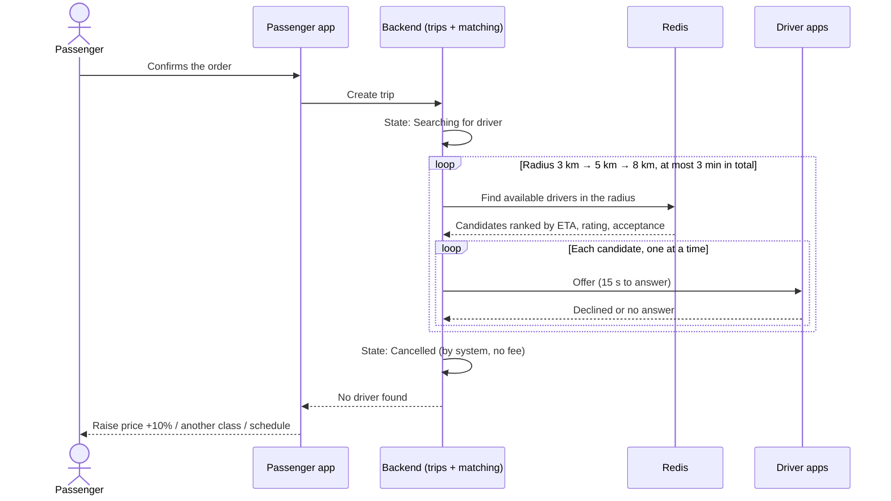
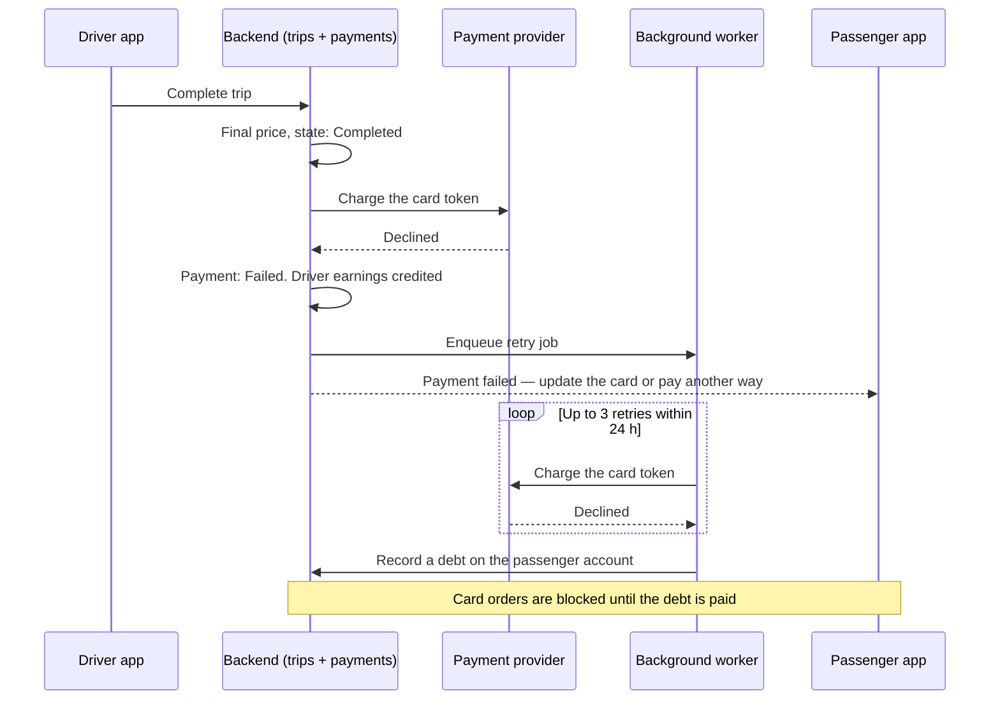

# Unhappy paths

Unhappy paths are scenarios where something goes wrong: a user makes a mistake, another actor does not respond, or a part of the system or an external service fails. For each one we define what the system does and what the user sees, so that no failure leaves a passenger or driver without a clear next step.

Numbers (timeouts, fees, limits) are the same as in the [functional](functional.md) and [non-functional](non-functional.md) requirements.

## Sign-in

| ID | Situation | What the system does | What the user sees | Requirements |
|---|---|---|---|---|
| UP-1 | Wrong code entered 5 times | Blocks sign-in for this phone number for 15 min and logs the event | "Too many attempts. Try again in 15 min" with a countdown | FR-1, NFR-13 |
| UP-2 | SMS code does not arrive | Allows a resend after 60 s, at most 10 code requests per hour per number. Each send is a queued job with retries | Resend button with a 60 s timer; after the second resend — a suggestion to sign in with Google or Apple | FR-1, NFR-13 |

## Ordering

| ID | Situation | What the system does | What the user sees | Requirements |
|---|---|---|---|---|
| UP-3 | Location permission denied or GPS accuracy worse than 50 m | Does not set the pickup point automatically | "Set your pickup point on the map" and a draggable pin | FR-3 |
| UP-4 | The 5-minute price estimate expires before the order is confirmed | Recalculates the price | New price with a note "Price updated", the passenger confirms again | FR-5 |
| UP-5 | **No driver found** | Searches within 3, 5, then 8 km; offers the order to one candidate at a time. After 3 min without acceptance cancels the order as "by system", with no fee. See the [sequence below](#no-driver-found) | "No drivers nearby right now" with options: raise the price by 10%, choose another class, schedule the ride | FR-8, FR-22, FR-35 |
| UP-6 | A driver declines or does not answer an offer in 15 s | Sends the offer to the next candidate. After 3 missed offers in a row the driver is switched to "offline" | Passenger: still "Looking for a driver…". Driver: "You were switched offline after 3 missed orders" | FR-21, FR-22 |
| UP-7 | The passenger has an unpaid debt | Blocks new orders with the card that failed | "You have an unpaid trip of ₴N. Pay it or choose another payment method" | FR-15 |

## Before pickup

| ID | Situation | What the system does | What the user sees | Requirements |
|---|---|---|---|---|
| UP-8 | The driver is more than 5 min late versus the promised ETA | Allows the passenger to cancel without a fee and offers a new search | "Your driver is late. Cancel free of charge or keep waiting" | FR-9, FR-10 |
| UP-9 | The driver cancels after accepting | Returns the order to search with priority; counts the cancellation in the driver's statistics | Passenger: "The driver cancelled. We are looking for another one" — no action needed | FR-22, FR-27 |
| UP-10 | The passenger does not come out | 3 min of free waiting, then paid waiting by the class tariff. After 15 min the driver can cancel; the passenger is charged a ₴50 fee | Passenger: waiting timer and its cost. Driver: "Cancel — passenger did not show up" button after 15 min | FR-9, FR-25 |
| UP-11 | The driver taps "Arrived" more than 150 m from the pickup point | Rejects the status change | Driver: "You are N m from the pickup point" | FR-24 |
| UP-12 | The passenger cancels after the free 2 minutes | Charges the ₴50 cancellation fee | Before confirming: "Cancellation fee ₴50" | FR-9 |

## During the trip

| ID | Situation | What the system does | What the user sees | Requirements |
|---|---|---|---|---|
| UP-13 | The passenger or driver app crashes or loses the connection | The trip continues on the server. Driver actions taken offline are queued and sent after reconnecting; retries use an idempotency key, so nothing is applied twice | After reopening, the app returns to the current trip within 10 s | NFR-8, NFR-9 |
| UP-14 | No driver positions for 5 min (phone died, power outage) | Flags the trip for support. Support completes it manually from the last known position and the planned route | Passenger: "Connection with the driver is lost" after 1 min without positions, with a "Contact support" button | FR-31, FR-32, NFR-8 |
| UP-15 | The final price differs from the estimate by more than 20% | Shows the reason (route change, waiting) in the receipt | Price breakdown and a "Dispute" button that opens a ticket for this trip | FR-19, FR-37 |
| UP-16 | SOS is pressed | Dials 112 and within 10 s sends coordinates, car and driver details to the safety team; the trip is highlighted on the admin map | Passenger: confirmation that help is notified and the trip link is shared | FR-13, FR-31 |
| UP-17 | Fake GPS is suspected (movement faster than 200 km/h between points) | Calculates the price from the map route instead of the GPS track and sends the driver to moderation | Driver: nothing until moderation decides. Passenger: normal receipt | FR-38 |

## Payment

| ID | Situation | What the system does | What the user sees | Requirements |
|---|---|---|---|---|
| UP-18 | The payment provider is unavailable | Card charges for completed trips are queued and retried. New orders can be paid in cash | "Card payments are temporarily unavailable. Pay in cash or try later" | FR-15, CON-6 |
| UP-19 | **Card declined after the trip** | The trip stays completed and the driver is credited. The charge is retried 3 times within 24 h, then recorded as a debt. See the [sequence below](#payment-failed-after-the-trip) | "Payment failed. Update your card or pay with another method" | FR-15, FR-26 |
| UP-20 | A provider webhook is lost or arrives twice | Webhooks are processed by payment ID, so a duplicate changes nothing. Payments without a confirmation are re-checked with the provider every 15 min | Nothing — the trip and receipt show the correct status | FR-15, NFR-12 |
| UP-21 | The passenger disputes a charge | Support reviews the trip route and payment; finance issues a full or partial refund within 3 business days | Ticket status and refund amount in the app | FR-19, FR-32 |

## System

| ID | Situation | What the system does | What the user sees | Requirements |
|---|---|---|---|---|
| UP-22 | Google Maps API is unavailable | Uses cached routes; otherwise estimates the price from the straight-line distance × 1.3 and hides the ETA | Price marked "approximate"; the final price is calculated from the actual route | FR-5, FR-37, CON-5 |
| UP-23 | One backend instance fails | The load balancer sends traffic to the second instance; WebSocket clients reconnect automatically | A short "Reconnecting…" banner, no lost trip | NFR-7, NFR-8 |
| UP-24 | Redis fails | The managed replica takes over. Driver positions are rebuilt from the next updates within seconds; queued jobs are persisted | Drivers may briefly disappear from the passenger map | NFR-1, NFR-8 |
| UP-25 | The SMS or push provider is down | Jobs stay in the queue and are retried. Trip status is still delivered to open apps over WebSocket | Sign-in: "Sign in with Google or Apple". Notifications may arrive late | FR-1, FR-14 |
| UP-26 | City-wide power outage or overloaded mobile network | Apps work on 3G and with packet loss, keep the last trip state offline and retry with backoff | Slower updates, but the order and the trip are not lost | NFR-9, NFR-10 |

## Key scenarios

### No driver found

### Payment failed after the trip

